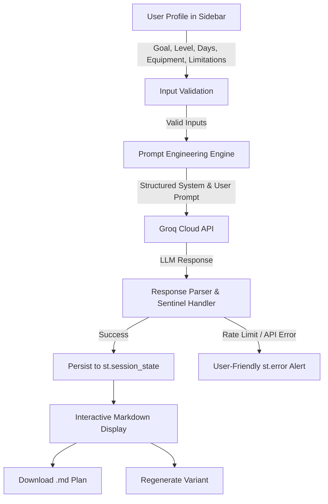

# 💪 AI Workout Plan Generator

[](https://streamlit.io/)
[](https://groq.com/)
[](https://www.python.org/)
[](https://opensource.org/licenses/MIT)

> An AI-powered Streamlit web application that collects structured fitness profile details and leverages the high-speed **Groq API** to generate personalized, safe, weekly workout routines.

---

## 🎬 Application Demo

### Video Walkthrough

GitHub's Markdown renderer strips raw interactive `<iframe>` embeds for security. Below you can view or stream the full demo video directly, along with the project demo assets:

<p align="center">
  <a href="https://drive.google.com/file/d/1pFqCj_QwADz9L3Q4jtzNZltk1eTR-P9F/view?usp=sharing" target="_blank">
    
  </a>
  &nbsp;&nbsp;
  <a href="https://drive.google.com/drive/u/0/folders/1c-QvGzPN56LwBHN7ZvlcJ77oXtH0PtTj" target="_blank">
    
  </a>
</p>

* 🔗 **Direct Video Stream:** [Google Drive Video Link](https://drive.google.com/file/d/1pFqCj_QwADz9L3Q4jtzNZltk1eTR-P9F/view?usp=sharing)
* 📂 **Demo Assets Folder:** [Google Drive Shared Folder](https://drive.google.com/drive/u/0/folders/1c-QvGzPN56LwBHN7ZvlcJ77oXtH0PtTj)

> **Note for documentation sites (Docusaurus, MkDocs, or HTML portfolios):**  
> You can embed the interactive player directly with the following code snippet:
> ```html
> <iframe src="https://drive.google.com/file/d/1pFqCj_QwADz9L3Q4jtzNZltk1eTR-P9F/preview" width="100%" height="480" allow="autoplay"></iframe>
> ```

---

## 🌟 Key Features

- **🎯 Structured Profile Collection:** Enforces structured inputs (Fitness Goal, Experience Level, Days/Week, Equipment Access, Limitations) to avoid generic, unhelpful plans.
- **🧘‍♂️ Injury & Limitation Aware:** Automatically adapts exercise selection to avoid aggravating injuries and attaches mandatory liability disclaimers.
- **📅 Day-by-Day Structure:** Complete weekly plans organized by day with specific exercises, target sets, rep ranges (or duration), rest intervals, and form tips.
- **🔄 One-Click Plan Regeneration:** Easily generate alternate variants without re-typing user inputs.
- **💾 Export as Markdown (.md):** Download the plan with one click for offline use or import into workout journal apps.
- **🎨 Polished Dark UI:** Deep slate aesthetic with high-contrast text, Inter typography, and responsive controls.
- **🛡️ Comprehensive Error Handling:** Graceful recovery with user-friendly alerts for missing API keys, rate limits, network connection failures, or empty responses.

---

## 🏗️ Architecture & Data Flow



---

## 🛠️ Tech Stack

| Layer | Technology | Description |
|---|---|---|
| **Frontend & UI** | [Streamlit](https://streamlit.io/) (1.35+) | Single-page reactive web application |
| **LLM Inference** | [Groq API](https://groq.com/) | Ultra-low latency LLM inference |
| **Model** | `openai/gpt-oss-120b` / `llama3-70b-8192` | State-of-the-art open-weight models |
| **Runtime** | Python 3.10+ | Core application logic with explicit typing |
| **Environment** | `python-dotenv` | Secure API key management |

---

## 🚀 Quick Start Guide

### 1. Clone the repository
```bash
git clone https://github.com/your-username/workout-plan-generator.git
cd workout-plan-generator
```

### 2. Set up a virtual environment (recommended)
```bash
python -m venv venv

# Windows:
venv\Scripts\activate

# macOS / Linux:
source venv/bin/activate
```

### 3. Install dependencies
```bash
pip install -r requirements.txt
```

### 4. Configure environment variables
Create a `.env` file in the project root:

```env
GROQ_API_KEY=your_actual_groq_api_key_here
GROQ_MODEL=openai/gpt-oss-120b
```

*(You can obtain a free Groq API key at [console.groq.com](https://console.groq.com))*

### 5. Run the application
```bash
streamlit run app.py
```

The app will automatically open at `http://localhost:8501`.

---

## 📁 Repository Structure

```
workout-plan-generator/
├── .streamlit/
│   └── config.toml          # Custom dark theme configuration
├── app.py                  # Main Streamlit application and Groq API logic
├── requirements.txt        # Python dependencies
├── .env                    # Local environment variables (DO NOT commit)
├── .env.example            # Template for environment variables
├── specification.md        # Product Specification Document
└── README.md               # GitHub documentation
```

---

## ⚙️ Environment Variables

| Variable | Required | Description | Example / Default |
|---|:---:|---|---|
| `GROQ_API_KEY` | ✅ Yes | Your Groq Cloud authentication key | `gsk_...` |
| `GROQ_MODEL` | ❌ Optional | Groq model identifier | `openai/gpt-oss-120b` or `llama3-70b-8192` |

---

## ⚠️ Safety & Liability Disclaimer

> **Disclaimer:** The workout routines generated by this tool are for informational and educational purposes only. They do not constitute personalized medical or physical therapy advice. Always consult a qualified physician or healthcare provider before beginning any new exercise regimen, particularly if you have pre-existing injuries or physical limitations.

---

## 📄 License

Distributed under the MIT License. See `LICENSE` for more information.
